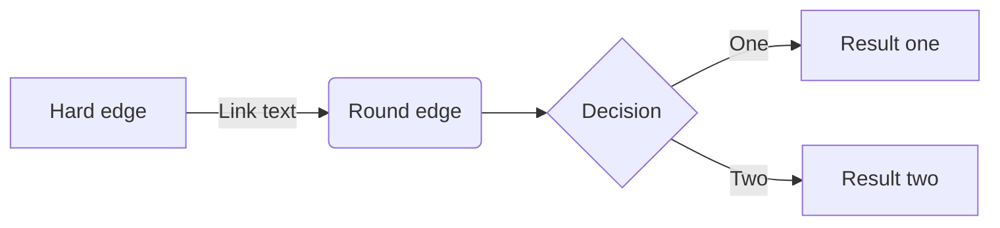

# Game Design Document (GDD)

Read the [project specification](https://github.com/feit-comp30019/project-2-specification) for details on what _actually_ needs to be covered here. While you should (obviously) delete everything here and replace it with an actual GDD before submitting your project, you may wish to keep a copy of it as a cheat sheet for how to use "GitHub flavoured markdown".

Ensure that _your game design document_ is `well written` and formatted **appropriately**.
Below are examples of markdown features available on GitHub that might be useful, though this is not an exhaustive list, nor is it required that you use all of these features.

### Table of contents

- [Introduction](#introduction)
- [Emojis and Icons :boom:](#emojis-and-icons)
- [Using Images](#using-images)
- [Code Snipets](#code-snippets)
- [Tables and Lists](#tables-and-lists)
- [Maths and Diagrams](#maths-and-diagrams)
- [References](#references)

### Introduction

_Exciting title_ is a first-person shooter (FPS) set in... we're not sure yet. It's a bit like _Doom_ meets _Animal Crossing_, but with a twist. The player must...

> "This is a quote from the game designer, explaining why this game is going to be the best thing since sliced bread." - Game Designer

### Gameplay and Mechanics
•	Player Perspective:
The game adopts a third-person perspective. The camera is positioned behind the player character and follows their movements smoothly, providing both spatial awareness of the environment and precise control for platforming.
•	Controls:
The player uses WASD keys for movement, Space to jump, and the left mouse button to switch colors once a color has been collected. The control scheme is intentionally minimalistic to allow players to focus on puzzle-solving rather than complex input sequences.
•	Progression and Objectives:
Players must collect and utilize colors to solve puzzles and advance through the environment. As progression continues, puzzles require the use of multiple colors and rapid switching between them. Falling outside the scene results in the player’s “death,” after which they respawn at the latest checkpoint. Upon reaching the final destination, a timer is displayed to indicate total completion time, encouraging replayability and optimization.
•	Core Mechanics:
The central mechanic is color-based interaction. The player can only physically interact with objects in the scene that share the same active color. For example, a blue character can stand on blue platforms, push blue blocks, or activate blue switches. Non-matching objects behave as intangible, creating the illusion of phasing through them. This mechanic is the foundation of both puzzle design and progression.
 
### Levels and World Design
•	Game World:
The game world consists of one large 3D environment rather than segmented levels. The design emphasizes exploration and continuity, with checkpoints strategically placed to reduce frustration after failure. Although no map system is provided, navigation signs and environmental cues guide players toward their objectives.
•	Objects and Assets:
The world features two main categories of objects:
1.	Decorative Objects: Large-scale props, such as oversized cans or static scenery, reinforce the miniature-world theme. These objects cannot be moved and do not interact with the player beyond serving as environmental boundaries or visual storytelling elements.
2.	Puzzle Objects: Interactive objects that respond to the player’s current color. These include platforms, blocks, switches, and moving elements, each requiring correct color alignment to function as intended.
•	Puzzle and Challenge Design:
Early puzzles introduce simple color-matching mechanics, while later challenges demand mastery of quick color switching, timed jumps, and multi-step problem solving. Some puzzles incorporate moving platforms or timed events, requiring both precision and strategy. Difficulty ramps up gradually, ensuring players are taught mechanics progressively before being tested on more complex combinations.
 
### Physics
•	Gravity and Jumping:
The player character is constantly influenced by gravity, resulting in natural falling and jumping arcs. Jumps apply an upward impulse that diminishes over time, creating a parabolic trajectory. Falling off platforms or leaving the scene boundary triggers a death-and-respawn cycle at the latest checkpoint.
•	Collision Detection:
All interactive objects have colliders. Collision is conditional on the player’s current color state: objects of matching color behave as solid, while non-matching objects allow the player to pass through. Decorative objects retain static colliders but serve only as barriers, not puzzle elements.
•	Movement and Forces:
Player movement is velocity-based, prioritizing responsive, arcade-style control rather than realistic acceleration. Puzzle blocks and pushable objects move in response to applied forces but remain restricted to simple linear motion for consistency and predictability.
•	Environmental Hazards and Boundaries:
Falling into void areas or outside the playable world results in an immediate reset. Dynamic objects such as moving platforms follow predetermined motion paths, ensuring puzzle timing remains consistent and learnable rather than random.
•	Interaction Logic:
All physics-based interactions are mediated through color. The player’s ability to stand, push, or activate an object depends entirely on matching color states. This creates a unique and intuitive rule system, making color-switching both a mechanical challenge and a core part of the narrative identity.


### Emojis and Icons

Check out [this page](https://github-emoji-picker.rickstaa.dev/) for a list of emojis/icons that you can use in your markdown. For example, you can use :sparkles: to make things sparkle! Use them sparingly and selectively, as too many emojis can be distracting, and some aren't super appropriate for a GDD. :wink: :wink: :wink:

### Using Images

Remember that your GDD should be a very visual document! It's easy to include images or gifs in your markdown, like this:

<p align="center">
  
</p>

### Code Snippets

Code is unlikely to be needed much (if at all) in your GDD, but it's still handy to know how to embed it. If you do include any `code snippets`, be sure to explain them properly.

```c#
public class CameraController : MonoBehaviour
{
    void Start ()
    {
        // Do something...
    }
}
```

### Tables and Lists

You can create tables using markdown, though it's a bit fiddly and not super customisable. Here's an example:

| Column 1 | Column 2 | Column 3 |
| -------- | -------- | -------- |
| Row 1    | Row 1    | Row 1    |
| Row 2    | Row 2    | Row 2    |
| Row 3    | Row 3    | Row 3    |

You can also create lists, like this:

- Item 1
- Item 2
- Item 3

Or like this:

1. Item 1
2. Item 2
3. Item 3

Or even nested lists like this:

1. Item 1
   - Item 1.1
   - Item 1.2
2. Item 2
   - Item 2.1
   - Item 2.2

### Maths and Diagrams

Like code, maths probably won't feature much in your GDD, but it's worth knowing that you can use LaTeX to write equations, and have them automatically render in your markdown:

$$\left( \sum_{k=1}^n a_k b_k \right)^2 \leq \left( \sum_{k=1}^n a_k^2 \right) \left( \sum_{k=1}^n b_k^2 \right)$$

... [look here](https://docs.github.com/en/get-started/writing-on-github/working-with-advanced-formatting/writing-mathematical-expressions) if you want to learn more about this.

It's also possible to [create diagrams](https://docs.github.com/en/get-started/writing-on-github/working-with-advanced-formatting/creating-diagrams) via GitHub flavoured markdown using an integrated tool called Mermaid. This is a pretty powerful tool, and it's worth checking out [this](https://mermaid.js.org/intro/) guide for more information on what it can do. As a quick example, here's a flowchart:



Pretty neat, huh? You can also create sequence diagrams, Gantt charts, class diagrams, and more. Check out the [Mermaid Live Editor](https://mermaid-js.github.io/mermaid-live-editor/) to see what's possible.

### References

Need more help? Check out these resources, which everything in this document is based on:

- [GitHub Flavoured Markdown](https://guides.github.com/features/mastering-markdown/) (official guide)
- [GitHub LaTeX](https://docs.github.com/en/get-started/writing-on-github/working-with-advanced-formatting/writing-mathematical-expressions)
- [GitHub Diagrams](https://docs.github.com/en/get-started/writing-on-github/working-with-advanced-formatting/creating-diagrams)
- [Mermaid Docs](https://mermaid-js.github.io/mermaid/#/)
- [Mermaid Live Editor](https://mermaid-js.github.io/mermaid-live-editor/)
- [Emoji Picker](https://github-emoji-picker.rickstaa.dev/)
