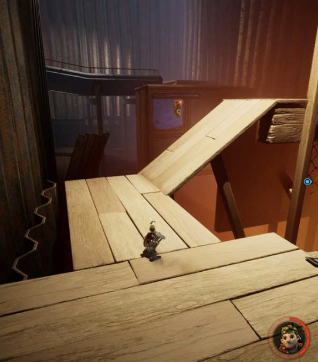
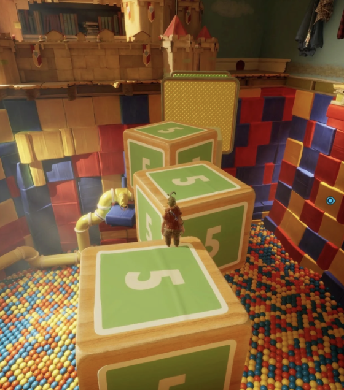
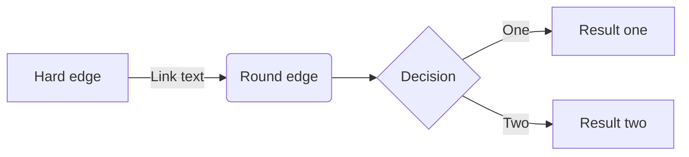

# Game Design Document (GDD)

Read the [project specification](https://github.com/feit-comp30019/project-2-specification) for details on what _actually_ needs to be covered here. While you should (obviously) delete everything here and replace it with an actual GDD before submitting your project, you may wish to keep a copy of it as a cheat sheet for how to use "GitHub flavoured markdown".

Ensure that _your game design document_ is `well written` and formatted **appropriately**.
Below are examples of markdown features available on GitHub that might be useful, though this is not an exhaustive list, nor is it required that you use all of these features.

### Table of contents

- [Introduction](#introduction)
- [Emojis and Icons :boom:](#emojis-and-icons)
- [Using Images](#using-images)
- [Code Snipets](#code-snippets)
- [Tables and Lists](#tables-and-lists)
- [Maths and Diagrams](#maths-and-diagrams)
- [References](#references)

### Game Overview
**•	Core Concept**: Our game is a color-based puzzle-platformer where the player navigates a miniature, dreamlike world by collecting and switching between colors. The unique mechanic is that player can only interact with objects that share their current active color. The platforms and switches become solid or intangible depending on the chosen color. This mechanic transforms simple movement into a constantly evolving puzzle, where success depends on mastering color switch,timing and spatial reasoning. The player's role is to journey through this environment, gradually restoring colorfulness and life to the world, with progression symbolized through colors collected along the way. 

**•	Related genre**: The game is a 3D puzzle-platformer genre, with influences from narrative-driven exploration games. Similar games includes It Takes Two (for stylized world and cooperative puzzle feeling) and Monument Valley (for spatial puzzles). Unlike other puzzle-platformers, this game features a unique color-matching mechanic in which colors shape both the world’s physics and the player’s progression. It blends the precision of platforming with a symbolic narrative of emotional healing.

**•	Target Audience**: The target audience is casual players who enjoy puzzle-platformers and atmospheric experiences. The game is especially suited for teenagers and university students who appreciate immersive gameplay and symbolic storytelling. 

**•	Unique Selling Points (USPs)**: 

• Color matching system - Platforms and switches exist only when matched with the player’s active color, creating fresh spatial puzzles.

• Evolving palette - The world shifts from muted blues to vibrant oranges, visually reflecting emotional growth.

• Story mechanic integration – Collecting colors ties emotional healing directly into gameplay.

• Replayability – Time trials encourage speedrunning and mastery beyond the first playthrough.

### Story and Narrative
**•	Backstory**: The world was vibrant and full of color, but a mysterious event drained it, leaving only muted blues and greys. In this fragile, miniature landscape, the player awakens as a small spirit-like figure carrying only one remaining color. Their journey is both literal and symbolic: to recollect the lost color and restore vibrancy to the world. With each color recovered, the environment gradually transforms, reflecting emotional healing and growth. The conflict is not against a villain but against darkness and despair, as the player overcomes challenges that resist the return of light. By the end of the journey, the world shines again in warm, symbolizing victory and renewal.

**•	Characters**: In our game, there is only one character—the player character, named Luma. Luma is a small, spirit-like figure that represents the player’s emotions. As colors gradually return to the world, Luma’s appearance subtly transforms, such as a brighter outfit or a soft glow. His personality is defined by innocence, determination, and adaptability. The player’s purpose through Luma is to restore vibrancy and color to the world.

### Gameplay and Mechanics
**•	Player Perspective**:
The game adopts a third-person perspective. The camera is positioned behind the player character and follows their movements smoothly, providing both spatial awareness of the environment and precise control for platforming.  

**•	Controls**:
The player uses WASD keys for movement, Space to jump, and the left mouse button to switch colors once a color has been collected. The control scheme is intentionally minimalistic to allow players to focus on puzzle-solving rather than complex input sequences.

**•	Progression and Objectives**:
Players must collect and utilize colors to solve puzzles and advance through the environment. As progression continues, puzzles require the use of multiple colors and rapid switching between them. Falling outside the scene results in the player’s “death,” after which they respawn at the latest checkpoint. Upon reaching the final destination, a timer is displayed to indicate total completion time, encouraging replayability and optimization.

**•	Core Mechanics**:
The central mechanic is color-based interaction. The player can only physically interact with objects in the scene that share the same active color. For example, a blue character can stand on blue platforms, push blue blocks, or activate blue switches. Non-matching objects behave as intangible, creating the illusion of phasing through them. This mechanic is the foundation of both puzzle design and progression.
 
### Levels and World Design
**•	Game World**:
The game world consists of one large 3D environment rather than segmented levels. The design emphasizes exploration and continuity, with checkpoints strategically placed to reduce frustration after failure. Although no map system is provided, navigation signs and environmental cues guide players toward their objectives.

**•	Objects and Assets**:
The world features two main categories of objects:
1.	Decorative Objects: Large-scale props, such as oversized cans or static scenery, reinforce the miniature-world theme. These objects cannot be moved and do not interact with the player beyond serving as environmental boundaries or visual storytelling elements.
2.	Puzzle Objects: Interactive objects that respond to the player’s current color. These include platforms, blocks, switches, and moving elements, each requiring correct color alignment to function as intended.

**•	Puzzle and Challenge Design**:
Early puzzles introduce simple color-matching mechanics, while later challenges demand mastery of quick color switching, timed jumps, and multi-step problem solving. Some puzzles incorporate moving platforms or timed events, requiring both precision and strategy. Difficulty ramps up gradually, ensuring players are taught mechanics progressively before being tested on more complex combinations.
 
### Physics
•	Gravity and Jumping:
The player character is constantly influenced by gravity, resulting in natural falling and jumping arcs. Jumps apply an upward impulse that diminishes over time, creating a parabolic trajectory. Falling off platforms or leaving the scene boundary triggers a death-and-respawn cycle at the latest checkpoint.

•	Collision Detection:
All interactive objects have colliders. Collision is conditional on the player’s current color state: objects of matching color behave as solid, while non-matching objects allow the player to pass through. Decorative objects retain static colliders but serve only as barriers, not puzzle elements.

•	Movement and Forces:
Player movement is velocity-based, prioritizing responsive, arcade-style control rather than realistic acceleration. Puzzle blocks and pushable objects move in response to applied forces but remain restricted to simple linear motion for consistency and predictability.

•	Environmental Hazards and Boundaries:
Falling into void areas or outside the playable world results in an immediate reset. Dynamic objects such as moving platforms follow predetermined motion paths, ensuring puzzle timing remains consistent and learnable rather than random.

•	Interaction Logic:
All physics-based interactions are mediated through color. The player’s ability to stand, push, or activate an object depends entirely on matching color states. This creates a unique and intuitive rule system, making color-switching both a mechanical challenge and a core part of the narrative identity.

### Art and Audio
**•	Art Style**:
The visual style of our game takes inspiration from It Takes Two - stylised, slightly surreal, and handcrafted , giving the world a playful yet emotionally impactful atmosphere. The overall color palette of our scene changes as the game progresses. It begins with cold, muted blues and greys symbolising sadness. As the player collects new colors, warmer tones gradually infuse the scene, visually representing healing and growth. The final scene will be orange in color representing triumph and renewal. 

Objects along the path in the scene - such as pencils, books, soda cans - maintain exaggerated, oversized forms to emphasize the miniature theme. Their textures evolve alongisde the player's progress in the game - dull and worn in the beginningm, then gradually infused with brightness, saturation and playful colors as the world evolves into a warm tone. 

Visual References from *It Takes Two*

|  |  |
|----------------------------------------|----------------------------------------|
| *Visual 1*                          | *Visual 2*                          |

**•	Sound and Music**:
The game's sound design is deliberately tied to the player's emotional progression and the color-based puzzle mechanic. In early stages, the maze feels hollow and fragile filled with soft wind, and sparse piano notes to reinforce the sense of emptiness and sadness. As new colors are collected, the environment grows richer, so does the music. Gentle chimes, faint hums, and brighter harmonies layer into the soundscape. By the final stage, the world is filled with uplifting and lively ambiences - sparkling tones and birdsong, symbolising renewal and hope.

**•	Assets**:
We will use a combination of custom-created, AI-generated, and sourced assets. 

3D Models - Rigged and animated player character through Mixamo and surrounding objects and collectibles sourced through Unity asset store
Sound - Freesound (https://freesound.org) for sound effects and ambiences, OpenGameArt (https://opengameart.org)

### UI/UX Design###
1. 📖 Information Archiecture 
	• **Main Menue** 
		• Game Start 
		• Chapter Selects
		• Settign (Volume/)
	• **Game Flow** 
		• Player enters -> Selects Chapter -> In-game Interaction 
	• **Naviation Logic** 
		• In-game -> Pasuse menu -> Return to chapter select/ Back to Main /Continue
	
2. 🎯 HUD
	• **Minimalist Style**: (almost no HUD, only necessary hints)
	• **Essential elements**:
		• Tap feedback(light Spark)
		• Path Guidance Arrows
		• Level Complete Promote (minimal text/ icon)

3. 🖥 Menue & Screens
	• **Main Menue** 
		• Minimal logo + "Start" button 
		• Soft Background music 
	• Chapter Select
		• Locked vs. unlocked distinction (bright vs. graycale)
	• **Seetings** 
		• Volume Slider
	• **Pause Menue** 
		• Continue 
		• Reutrn to Chapter
		• Return to Main Menue
4. 🎮 Interaction Design 
	• **Controls**:
		• keybords ("WASD"): To move 
		• Tap: Swipe Color 
	• **Feedback** 
		• Valid tap area -> relatively light spark light 
	• **Transitions** 
		• Scene changes -> smooth fade-in/out
		• Menues -> scale/ fade transitions 
5. 💡 User Experience 
	• **OnBoadrding**: First Level serves as natural tutorial 
6. 🎨 UI Visual Style Guide 
	• **Color Palette**: soft pastel tones
	• **Typography**:  minimalist, clear


### Technology and Tools
•	Unity 6.1x - core engine for development of game
•	Github - version control, merge codes, code reviews
•	Slack - daily team communications and task assignments
•	Mixamo - quick rigging and character animations 
•	Tripo AI - generate base 3D models from concepts 
•	Blender - optimise mesges , refine textures, and polish models 

### Team Communication
We will use Slack as our main communication platform for daily updates, discussion, organising and assigning tasks. All communication will be in English to ensure inclusivity and transparency for both the team and teaching staff.

•	Timeline:
Week 6-7: Discuss and finalise game design document
Week 8-10: Assets integration and imported to unity, core gameplay loop developed (jumping, movements, challenges)
Week 11: Work on gameplay video and upload to youtube 
Week 12: Final polishes to the game 

### Possible Challenges
•	WebGL Performance: Models generated through Tripo may be too heavy causing longer loading times
    Plan: optimise assets using Blender (compress textures)
•	Time Constraints: limited weeks to complete the project
    Plan: keep scope tight - focus on one single long scene and polish it instead of having multiple unpolished scene


### Emojis and Icons

Check out [this page](https://github-emoji-picker.rickstaa.dev/) for a list of emojis/icons that you can use in your markdown. For example, you can use :sparkles: to make things sparkle! Use them sparingly and selectively, as too many emojis can be distracting, and some aren't super appropriate for a GDD. :wink: :wink: :wink:

### Using Images

Remember that your GDD should be a very visual document! It's easy to include images or gifs in your markdown, like this:

<p align="center">
  
</p>

### Code Snippets

Code is unlikely to be needed much (if at all) in your GDD, but it's still handy to know how to embed it. If you do include any `code snippets`, be sure to explain them properly.

```c#
public class CameraController : MonoBehaviour
{
    void Start ()
    {
        // Do something...
    }
}
```

### Tables and Lists

You can create tables using markdown, though it's a bit fiddly and not super customisable. Here's an example:

| Column 1 | Column 2 | Column 3 |
| -------- | -------- | -------- |
| Row 1    | Row 1    | Row 1    |
| Row 2    | Row 2    | Row 2    |
| Row 3    | Row 3    | Row 3    |

You can also create lists, like this:

- Item 1
- Item 2
- Item 3

Or like this:

1. Item 1
2. Item 2
3. Item 3

Or even nested lists like this:

1. Item 1
   - Item 1.1
   - Item 1.2
2. Item 2
   - Item 2.1
   - Item 2.2

### Maths and Diagrams

Like code, maths probably won't feature much in your GDD, but it's worth knowing that you can use LaTeX to write equations, and have them automatically render in your markdown:

$$\left( \sum_{k=1}^n a_k b_k \right)^2 \leq \left( \sum_{k=1}^n a_k^2 \right) \left( \sum_{k=1}^n b_k^2 \right)$$

... [look here](https://docs.github.com/en/get-started/writing-on-github/working-with-advanced-formatting/writing-mathematical-expressions) if you want to learn more about this.

It's also possible to [create diagrams](https://docs.github.com/en/get-started/writing-on-github/working-with-advanced-formatting/creating-diagrams) via GitHub flavoured markdown using an integrated tool called Mermaid. This is a pretty powerful tool, and it's worth checking out [this](https://mermaid.js.org/intro/) guide for more information on what it can do. As a quick example, here's a flowchart:



Pretty neat, huh? You can also create sequence diagrams, Gantt charts, class diagrams, and more. Check out the [Mermaid Live Editor](https://mermaid-js.github.io/mermaid-live-editor/) to see what's possible.

### References

Need more help? Check out these resources, which everything in this document is based on:

- [GitHub Flavoured Markdown](https://guides.github.com/features/mastering-markdown/) (official guide)
- [GitHub LaTeX](https://docs.github.com/en/get-started/writing-on-github/working-with-advanced-formatting/writing-mathematical-expressions)
- [GitHub Diagrams](https://docs.github.com/en/get-started/writing-on-github/working-with-advanced-formatting/creating-diagrams)
- [Mermaid Docs](https://mermaid-js.github.io/mermaid/#/)
- [Mermaid Live Editor](https://mermaid-js.github.io/mermaid-live-editor/)
- [Emoji Picker](https://github-emoji-picker.rickstaa.dev/)
