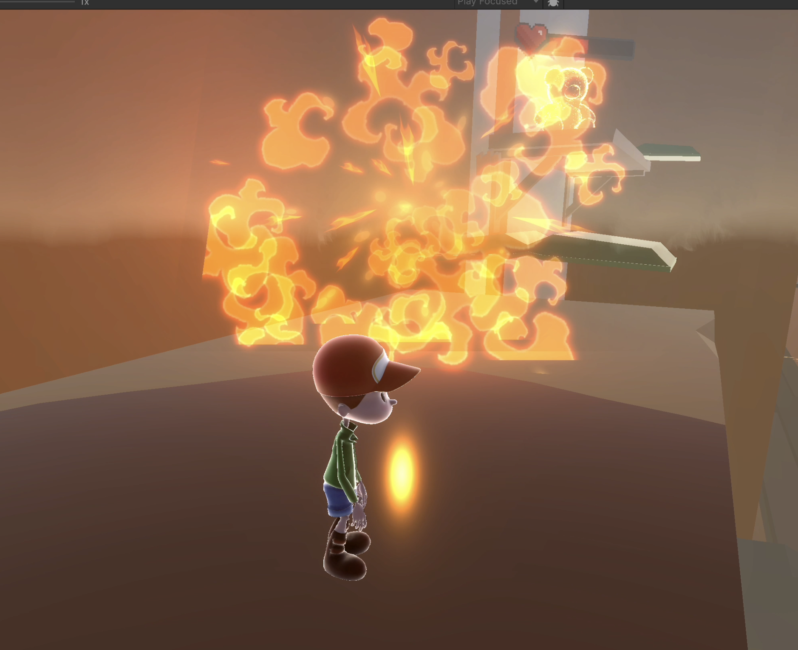
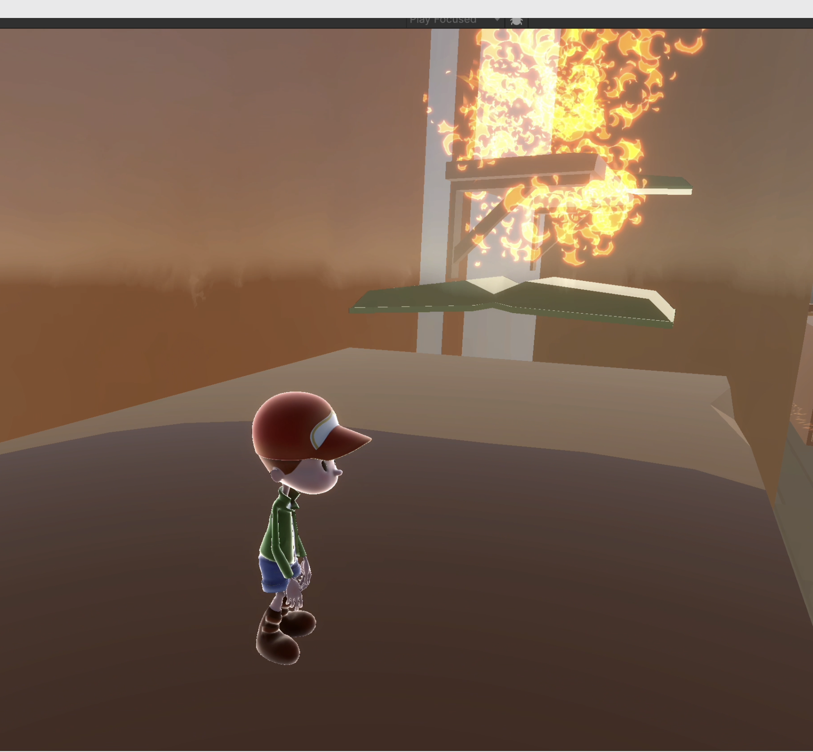
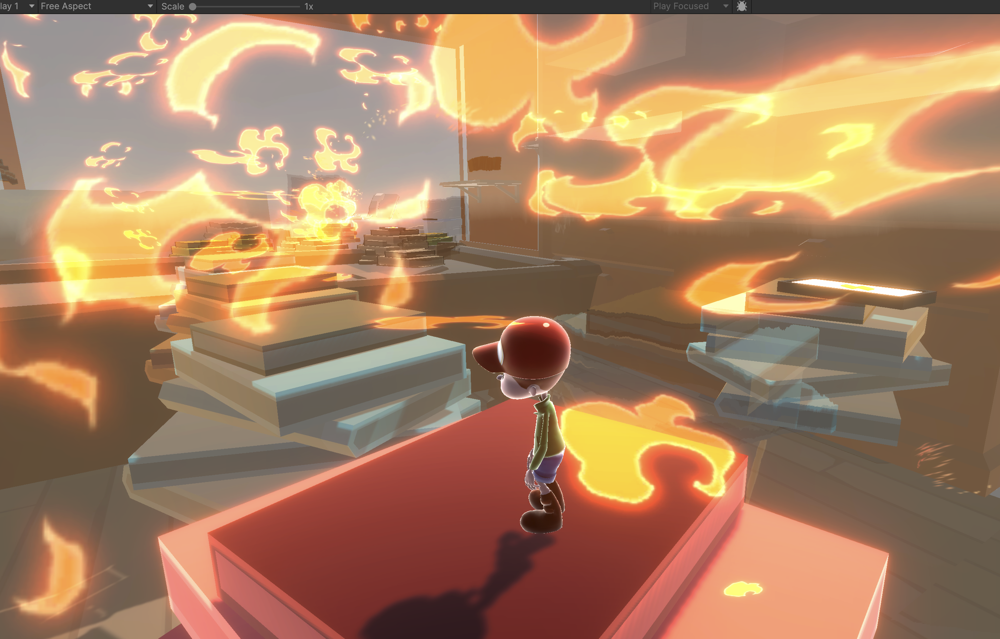

# Project 2 Report

Read the [project 2
specification](https://github.com/feit-comp30019/project-2-specification) for
details on what needs to be covered here. You may modify this template as you
see fit, but please keep the same general structure and headings.

Remember that you should maintain the Game Design Document (GDD) in the
`README.md` file (as discussed in the specification). We've provided a
placeholder for it [here](README.md).

## Table of Contents

- [Evaluation Plan](#evaluation-plan)
- [Evaluation Report](#evaluation-report)
- [Shaders and Special Effects](#shaders-and-special-effects)
- [Summary of Contributions](#summary-of-contributions)
- [References and External Resources](#references-and-external-resources)

## Evaluation Plan
**•	Evaluation techniques**:

Observational technique - Think aloud

We will ask 5 participants to play the game while verbalising their thoughts aloud. This technique helps us understand players’ reasoning and identify usability problems, such as confusing controls or unclear objectives, by directly observing their behaviour and listening to their thought process. During the session, we will record the screen and take notes on where players hesitate or get stuck.

Query technique - Post game questionnaires

After finishing the play session, 5 different participants will complete the GUESS-18 (Game User Experience Satisfaction Scale) questionnaire. This technique is useful for gathering quantitative feedback on enjoyment, difficulty, and visual appeal, as well as what players liked or disliked. It allows us to evaluate players’ overall satisfaction and perceived fun of the game.

**•	Participants**:

We will recruit 10 participants (5 for Think-Aloud, 5 for GUESS-18), mainly from the University of Melbourne student community, aged 18–30. This group represents our target audience, as the game is aimed at young adults who enjoy puzzle-solving based games. Participants will be recruited through class announcements and online student groups. They should have basic gaming experience but no prior knowledge of our game to ensure unbiased feedback.

**•	Data collection**:

Both qualitative and quantitative data will be collected to evaluate player experience. Qualitative data will include players’ spoken thoughts, comments, and observed behaviours during the Think-Aloud sessions, helping to identify usability issues and emotional reactions. Quantitative data will come from participants’ responses to the GUESS-18 questionnaire, which provides measurable scores on enjoyment, playability and usability.

Gameplay sessions will be screen-recorded while participants verbalise their thoughts, and observer notes will be taken on key events or difficulties.

After gameplay, participants will complete a Google Form version of the GUESS-18 survey, allowing responses to be stored digitally and exported for analysis. Data will be collected and organised using built-in screen recording, Google Forms, and Excel, with additional qualitative insights documented through observation notes.

**•	Data analysis**:

We will analyse both qualitative and quantitative data to evaluate the game’s usability and overall player experience.

Qualitative data from the Think-Aloud sessions will be reviewed through thematic analysis. We will watch the recorded sessions and patterns such as confusion points, navigation issues, or emotional reactions. These insights will help identify specific design problems, such as unclear controls or visual feedback, and guide improvements. 

Quantitative data from the GUESS-18 questionnaire will be analysed using descriptive statistics (mean and standard deviation) for each dimension—enjoyment, playability, usability, aesthetics, and immersion.

Average scores below a set threshold (e.g., 3.5/5) will indicate areas needing refinement. We will also compare participants’ written comments to interpret the reasons behind lower ratings.

**•	Timeline**:

The evaluation process will take place over two weeks. During Week 10, we will recruit participants and conduct the Think-Aloud sessions, collecting qualitative data on usability and player experience. In Week 11, we will distribute the GUESS-18 questionnaire to a separate group of participants and collect quantitative feedback. Once all data has been gathered, we will perform data analysisin the following days, identifying key usability and design issues. Game refinements based on these findings will be implemented before the final submission deadline, ensuring that improvements are informed by real user feedback.

**•	Responsibilities**:

One member will be responsible for organising and conducting the Think-Aloud sessions, including participant coordination, screen recording, and taking observation notes. Another member will handle the GUESS-18 questionnaire, creating the Google Form, distributing it to participants, and collecting responses.

All team members will collaboratively analyse the data. Finally, the whole team will participate in discussing and implementing game improvements based on the evaluation findings.

To ensure equal contribution, we will:

• Assign clear, documented responsibilities for each task.

• Conduct regular to monitor progress and share updates.

• Make all evaluation materials (recordings, forms, notes) accessible to all team members for transparency.

## Evaluation Report

The goal of our evaluation was to identifu usability problems, gameplay clarify issue and design weaknesses taht affected player enjoyment and immersion. We used both observational and survey-based methods to gather detailed feedback, and we implemented serval targeted improvements based on the results. 

**•	Findings and improvemnts**:

• Objective and gameplay clarity: Many players were unsure about their goals when a level started and could not easily distinguish interactable objects.

Improvements: Added instructional panels explaining level objectives. Glowing phones were made interactive, and proximity prompts now trigger new gameplay mechanics to help players understand progression.

• Atmosphere and immersion: Players noted the absence of a background story and music, which made the experience feel flat and less engaging.

Improvements: Introduced a short background story at game start, added background music and movement sound effects, and implemented additional shaders to make visuals more appealing and immersive.

• Game design and navigation: Some players reported getting lost or needing to walk long distances to return after falling off the table. Others found early puzzles too simple.

Improvements:Added guiding particle effects and shortcuts to help players return to the correct path quickly. Designed three new levels with progressive difficulty and introduced new puzzle elements, such as movable books that open paths, traps that break after jumps, and more interactions between World A and World B objects.

• Feedback and reward system: Players were uncertain when they had successfully completed an objective, as there was no clear success indicator.

Improvements: Added visual “Victory” message and audio feedback for successful interactions at the end of the game to clearly signal completion.

• Controls and responsiveness: Participants found the controls not straightforward. And the absence of smooth mouse control for adjusting the camera limited participants' navigation flexibility.

Improvements: Implemented mouse-based camera control, allowing players to freely and smoothly adjust their view during gameplay. Added on-screen UI prompts such as “Press E to view the instruction”, guiding players through core controls and improving overall responsiveness.

• Bug and collision issues: Some players were able to pass through certain obstacles or triggers failed to activate.

Improvements: Refined collider boundaries, adjusted trigger sizes, and tested all interactable objects to ensure consistent activation.

## Shaders and Special Effects

The core gameplay of this project is fundamentally based on transitions between different states. The game world is composed of two main types of objects: decorative elements and puzzle objects. To achieve a more stylized visual effect, this project employs two types of shaders `PortalShader.Shader` and `CustomCelToon.Shader` (file Path: Project -> Shaders) 

### 1. PortalShader.Shader
A shader specifically designed for the portal effect between world A (WorldShared) to world B. 

The portal effect is achieved through two cameras. Main camera captures the world Shared, while the other only renders the objects in world B. The image from the second camera is passed to the portal shader through "Render to Texture" technic  and further calculations to generate the visual effect of the portal.

To create the magical and smooth feeling of a portal, we applied the ApplyWave() function in the vertex shader. This function mainly moves the vertices along the x-axis and z-axis, thereby generating a similar wave-like motion effect.
In addition, to enhance the surreal contrast between the two worlds, after sampling the rendered texture that belongs only to world B, we applied a shake effect in the fragment shader, making the objects in world B exhibit a unique vibration sensation, highlighting their otherworldly characteristics.

**Exposed Shader Parameters (PortalShader)**

| Category | Key Parameters | Description |
|-----------|----------------|--------------|
| **Color & Opacity** | `_Tint`, `_Opacity` | Control overall color and transparency of the portal. |
| **Lighting & Style** | `_RampTex`, `_RampU`, `_FresnelPow`, `_FresnelBoost` | Define toon shading ramp and edge highlight strength. |
| **Wave Motion** | `_WaveAmp`, `_WaveFreq`, `_WaveSpeed`, `_WaveDir1`, `_WaveDir2`, `_WaveSizeComp` | Control surface distortion for the magical fluid look. |
| **World B Rendering** | `_PortalRT`, `_PortalColorBlend`, `_EdgeFeather` | Manage render texture blending and smooth edge transitions. |
| **Noise & Shake** | `_NoiseTex`, `_InsideShakeStrength`, `_ShakePixels` | Add pixel shake and instability inside the portal for World B. |

### 2. CustomCelToon.Shader
A toon shader applied to specific puzzle objects to realize a distinctive color scheme, toon-style lighting, and material effects. General effects are list below

1. **Outline**:
 	generates an outline by offsetting each vertex along its view-space normal direction, createting a solid black contour that wraps around the model.

2. **Cel Shading (Diffuse Quantization)**:
	The base diffuse term uses the Lambert reflection model (`I_diffuse = k_d * (N · L) * I_L`)

	It is then quantized into discrete brightness stepsquantized into discrete brightness steps, transforming smooth lighting gradients into flat light and shadow regions 

3. **Specular Highlight**:
	A thresholded Blinn-Phong model is used for stylized specular highlights. 
	C_specular = I_spec_toon * SpecStrength * SpecColor * LightColor * Attenuation
	This approach provides strong artistic control over highlight shape, brightness, and softness.

4. **Rim Light**:
The rim light is calculated based on view direction and surface normal(`1 - dot(N, V)`). 
By applying rim color `I_rim = (1 - N · V)^RimPower`, it adds a subtle glow along the model’s edges. 

5. **Shadow Fade**:
	To avoid harsh shadows in distant areas, lighting fades with distance from the camera `Fade = 1 - smoothstep(ShadowFadeStart, ShadowFadeEnd, CameraDistance)`. 
	Final diffuse term after fading: `I_final = I_toon * Fade` This technic maintains consistent brightness and ensures soft, readable shading transitions

**Exposed Shader Parameters (CelToonShader)**
| Category |Key Parameters | Description |
|---------------|--------------------|------------------|
| **Base Color** | `_MainTex`, `_Color` | Defines the base texture and overall tint color. |
| **Outline** | `_OutlineColor`, `_OutlineWidthPx` | Controls the outline color and its thickness in screen space. |
| **Cel Lighting (Diffuse Quantization)** | `_Steps`, `_Feather` | Determines the number of light bands and the smoothness between them; lower steps create a stronger toon look. |
| **Specular Highlight** | `_SpecColor`, `_SpecStrength`, `_SpecThreshold`, `_SpecFeather`, `_Gloss` | Controls the color, intensity, threshold, and softness of the specular highlight; `_Gloss` affects sharpness. |
| **Rim Lighting** | `_RimColor`, `_RimPower` | Defines rim light color and intensity, creating glow facing away from the camera. |
| **Shadow Control** | `_ShadowFadeStart`, `_ShadowFadeEnd`, `_MinShadow` | Controls shadow fading based on camera distance and the minimum brightness of shaded regions. |

##  Particle Effects
When **Barry (beer)** fires a bullet, a unique **explosive particle effect** is triggered.  
Similar **high-temperature explosion effects** also occur when players destroy certain parts of the *Books blocks*.  

In addition, to enhance visual presentation, when the player attempts to pass the book path for the first time, a vertical flame spray will appear.

The explosion effect is implemented by generating approximately thirty spherical emission particles at the moment an object disappears.  

To simulate the release of energy, the explosion effect combines:
- **Deceleration (damping)** of particle emission speed  
- **Additional particle systems** such as flames, flame light, and light particles  

These layers together create a and dynamic visual effect that enhances the sense of impact.

---

### Visual References from *Particle System in Action*

| |  |  |
|----------------------------------------------------|----------------------------------------------------------|----------------------------------------------------|
| *Bullet firing particle effect*                    | *Object explosion effect*                                | *Path spark & flame spray effect*                  |

related Particle prefabs are stored under the following path: Project -> Prefabs -> Particle

## Summary of Contributions

**Rebecca**: Primarily responsible for character implementation, user interface design, and sound integration.
- Character Implementation: Imported and configured the main player model from Mixamo, including all associated animations (walk, run, jump). Developed and refined the player movement script to ensure smooth transitions between animations and responsive control.
- Camera Follow & Additional Animations: Helped with adjusting third-person camera follow system to achieve smoother movement and mouse control. Additionally implemented the player's dance animation switcher - allowing player to trigger and switch between multiple animations such as HipHop dance and Sad idle - to visually express the player's emotions throughout the game, enhancing the storytelling and presentation in the gameplay video.
- User Interface Design: Designed and implemented - Main Menu, Settings Menu, Pause Menu, Boss Health Bar, Victory Screen, and Introduction Story panel. Each interface was integrated with button logic for navigation and settings control. 
- Background Music & Sound Effects: Imported and integrated multiple background music tracks (sad, happy, victory) and sound effects such as footsteps for the player, button clicks, and keyboard typing sounds for the story panel. Implemented the logic for background music switching bewteen both worlds (A and B) and synchronized UI sound feedback.
- Puzzle Logic: Developed one puzzle interactions - when player jumps on a stack of books, the stack changes color on the first jump and explodes on the second. Also incorporated the particle effect for the explosion, the particle system effect for the explosion was implemented by another teammate. 

**Tom**: Primarily responsible for level design, lighting setup, and core gameplay system implementation (Block and Boss Shooting systems).  
- Level Design: Designed and constructed the full playable level layout, including platform arrangement, spatial pacing, and puzzle flow between World A and World B. Ensured that the progression maintains both challenge and clarity, providing visual and gameplay guidance for the player.  
- Lighting Setup: Configured and fine-tuned the Directional Light to achieve consistent illumination and shadow quality across the scene. Adjusted light angles, intensity, and color tone to highlight key gameplay areas and enhance the game’s overall atmosphere.  
- Block System Implementation: Developed and maintained several interactive block scripts — `ClickCycleMover_Curve.cs`, `PopInBounce.cs`, and `TimedDespawn.cs`. These scripts control block movement cycles, activation timing, and visual feedback, contributing to dynamic puzzle mechanics and environmental responsiveness.  
- Boss Shooting System: Implemented the complete boss combat logic, including `BossShooter.cs`, `KnockBackReceiver.cs`, `PlayerHitReceiver.cs`, `ReflectableBullet.cs`, and `ReflectWall.cs`. These scripts manage boss projectile attacks, bullet reflection, player knockback feedback, and wall collision responses.  

**Jason**:  Primarily responsible for visual design and technical graphics implementation, including portal and toon shader development, World B visual and interaction design, post-rendering effects for world transitions, scene layout construction, and particle effect implementation.
- Shader Development: Created and optimized both the `PortalShader.Shader` and `CustomCelToon.Shader`. The portal shader enables seamless visual transitions between WorldShared and World B, while the toon shader enhances the stylized rendering of characters and environments, ensuring a cohesive art direction.
- Portal & World B Visual Design: Designed and implemented all visual and interactive elements exclusive to World B, including the portal’s appearance, material transitions when players move between worlds.
- Post-Rendering Transition Effects: Developed post-processing effects for world switching, ensuring smooth visual blending and distinct atmosphere contrast between the two worlds.
- Scene Layout & Environment Setup: Responsible for overall scene composition and layout, arranging spatial elements and environmental details to achieve both aesthetic balance and gameplay clarity.
- Particle Effects: Implemented the explosion particle system, refining particle behavior, timing, and visual intensity to synchronize with gameplay events and enhance immersion.

**Grace**: Primarily responsible for user instruction interface design, shader effects, and interactive object implementation.

- UI and Player Guidance:
Designed and implemented the user instruction system to guide players through each level’s controls and objectives. Developed and integrated key scripts including HelpAddonController.cs, PickupPrompt.cs, and ProximityTriggerRelay.cs, which display contextual prompts and interaction cues in the game.

- Visual Design:
Created a glowing shader for the bear character using Shader Graph, enhancing visual feedback and emphasizing interactivity through dynamic glow effects.

- Gameplay Interaction:
Implemented movable objects and interactive mechanics through the scripts Levitatable.cs and WandController_Joint.cs, allowing players to manipulate objects within the environment to solve puzzles.

- Documentation and Evaluation:
Authored the Game Overview and Story and Narrative sections in the Game Design Document (GDD).
Contributed to the Evaluation Plan and Evaluation Report, outlining user testing methods, findings, and design improvements based on player feedback.

## References and External Resources

### Asset References

- **Bezier Solution** – by *Yasirkula*. Version 2.3.4 (Updated: Mar 10, 2025).  
  Used for implementing smooth Bezier curve path generation and control systems in Unity.  
  [Unity Asset Store Link](https://assetstore.unity.com/packages/tools/level-design/bezier-solution-113074)

- **Bedroom / Interior – Low Poly** – by *Fries and Seagull*. Version 1.1.6 (Updated: Jan 8, 2025).  
  Used for low-poly interior environment design and furnishing props (e.g., desks, chairs, decor).  
  [Unity Asset Store Link](https://assetstore.unity.com/packages/3d/props/interior/bedroom-interior-low-poly-assets-295074)

- **Office Supplies Low Poly** – by *Sten Ulfsson*. Version 1.01 (Updated: Jan 3, 2018).  
  Used for additional small scene details such as pens, papers, and stationery props.  
  [Unity Asset Store Link](https://assetstore.unity.com/packages/3d/props/office-supplies-low-poly-105519)

- **Polygon Office – Low Poly 3D Art** – by *Synty Studios*.  
  Used for 3D office environment modeling and decorative assets within the playable level.  
  [Unity Asset Store Link](https://assetstore.unity.com/packages/3d/props/interior/polygon-office-low-poly-3d-art-by-synty-159492)

- **ForceField Effects (Noisy & Ramp)** – by *Archanor VFX*.  
  Used for creating particle effects of portal.  
  [Unity Asset Store Link](https://assetstore.unity.com/packages/vfx/particles/spells/forcefield-effects-123431)

- **Particle System Tutorial** – from *Bilibili Video (BV14V411m7P5)*.  
  Tutorial reference used to learn and refine custom particle system behavior and shader control.  
  [Watch on Bilibili](https://www.bilibili.com/video/BV14V411m7P5/?spm_id_from=333.1391.0.0&vd_source=45ce09ea2751fe2431720b2d64de6d34)

- **Character & Animations** – from *Mixamo*
Used for character model and movements animations 
[Character] (https://www.mixamo.com/#/?page=1&query=timmy&type=Character)
[Idle Animation] (https://www.mixamo.com/#/?page=1&query=idle&type=Motion%2CMotionPack)
[Run Animation] (https://www.mixamo.com/#/?page=1&query=running&type=Motion%2CMotionPack)
[Fast Run] (https://www.mixamo.com/#/?page=1&query=fast+run&type=Motion%2CMotionPack)
[Jump] (https://www.mixamo.com/#/?page=1&query=jump&type=Motion%2CMotionPack)
[House Dancing] (https://www.mixamo.com/#/?page=1&query=dance&type=Motion%2CMotionPack)
[Excited] (https://www.mixamo.com/#/?page=1&query=excited&type=Motion%2CMotionPack)
[Hip Hop Dancing] (https://www.mixamo.com/#/?page=1&query=hip+hop+dancing+&type=Motion%2CMotionPack)
[Sad Idle] (https://www.mixamo.com/#/?page=1&query=sad+idle&type=Motion%2CMotionPack)
[Sitting Disbelief] (https://www.mixamo.com/#/?page=1&query=sitting+disbelief&type=Motion%2CMotionPack)
[Rejected] (https://www.mixamo.com/#/?page=1&query=rejected&type=Motion%2CMotionPack)

- **Teddy Bear Model** - from *Tripo Studio*
[Tripo Studio Link](https://studio.tripo3d.ai/home?utm_source=google&utm_medium=cpc&utm_campaign=studioall-1&utm_term=&gad_source=1&gad_campaignid=22631109747&gbraid=0AAAAA-fm6S4MQmrT4Bm7M9MISMrSTr2MM&gclid=CjwKCAiAwqHIBhAEEiwAx9cTeZR9GwMllg9bUiBTeBID9I8nJeKu4PfjL932pKzui7Wof3lBv_SonBoCOpIQAvD_BwE
)

- **Sound Effects** 
  Used for sad, happy, and victory background music. Sound effects for player's footsteps and button clicks.  
  - **Footsteps - Essentials** 
  [Unity Asset Store Link](https://assetstore.unity.com/packages/audio/sound-fx/foley/footsteps-essentials-189879)
  - **Free UI Click Sound Pack** 
  [Unity Asset Store Link](https://assetstore.unity.com/packages/audio/sound-fx/free-ui-click-sound-pack-244644)
  
- **Background Music** 
  - **Sad BGM for World A** - by *Clavier-Music* 
  [Pixabay Link](https://pixabay.com/music/ambient-relaxing-ambient-music-nostalgic-memories-310690/)
  - **Victory Music** - by *Tatamusic* 
  [Pixabay Link](https://pixabay.com/music/main-title-winner-victory-champions-background-music-394839/)
  - **Happy BGM for World B**
  [Pixabay Link](https://pixabay.com/music/ambient-wondrous-waters-119518/)
  
- **Health and Hearts Bar** – by *VampireGirl*
For the health bar of teddy bear boss shooter  
[itch.io Link](https://fliflifly.itch.io/hearts-and-health-bar)

- **UI Icons - 3D Low Poly Style** - by *Frangoroo*
For UI instruction panels.
[Unity Asset Store Link](https://assetstore.unity.com/packages/2d/gui/icons/ui-icons-3d-low-poly-style-244283)

- **Fonts** 
[Google Font Link](https://fonts.google.com/specimen/Luckiest+Guy?query=luckiest+guy+)
[Google Font Link](https://fonts.google.com/specimen/Titan+One?query=titan+one+)

